<p align="center">
  
</p>

<p align="center">
  <a href="#준비물"></a>
  &nbsp;
  <a href="LICENSE"></a>
  &nbsp;
  
</p>

<p align="center">
  AI 에이전트에게 링크 하나만 주면 <b>가게 조사 → 업종·브랜드 맞춤 전략 → 이번 주 주제 찾기 → 블로그·카드뉴스·숏폼 제작 → 법규 검수 → 업로드 → 성과 확인</b>까지 해 주는 AI 에이전트 스킬이에요.<br>
  피클, ChatGPT, Codex, Claude 등 링크를 읽을 수 있는 에이전트에서 쓰도록 만들었어요. 광고비 0원 기준이에요.
</p>

<p align="center">
  <a href="#사용법"><b>사용법</b></a>
  &nbsp;&nbsp;&nbsp;
  <a href="#이렇게-진행돼요"><b>진행 순서</b></a>
  &nbsp;&nbsp;&nbsp;
  <a href="#준비물"><b>준비물</b></a>
  &nbsp;&nbsp;&nbsp;
  <a href="#결과-예시"><b>결과 예시</b></a>
  &nbsp;&nbsp;&nbsp;
  <a href="#자주-묻는-것"><b>자주 묻는 것</b></a>
  &nbsp;&nbsp;&nbsp;
  <a href="#주의사항"><b>주의사항</b></a>
</p>

## 만든 이유

마케팅에 돈을 쓰기 어렵고 시간도 없는 사장님이 많아요. 그래서 AI가 시니어 마케터처럼 매주 먼저 가게를 살피고, 할 일을 챙겨 드리도록 만들었어요.

## 사용법

에이전트(피클 등)에 아래 한 줄을 보내세요. 상호와 지역, 가게 링크(플레이스·인스타·홈페이지 중 아무거나)를 같이 적으면 더 빨라요.

```
https://raw.githubusercontent.com/Whosekey-Labs/kr-marketing-skill/main/SKILL.md 이 지침 읽고 그대로 해줘. 우리 가게 마케팅 맡아줘. (상호·지역·가게 링크)
```

그다음은 에이전트가 묻는 대로 답하면 돼요. 먼저 가게를 조사하고, 꼭 필요한 것만 물어봐요.

<details>
<summary><b>Claude Code에서 스킬로 두고 쓰기</b></summary>

- 위 한 줄을 그대로 보내도 돼요(링크를 읽어 지침대로 시작해요).
- 스킬로 두려면 작업 폴더에서 아래처럼 받아 두세요. 새로 시작한 Claude Code의 스킬 목록에 `kr-marketing-skill`로 잡혀요.

```bash
git clone https://github.com/Whosekey-Labs/kr-marketing-skill .claude/skills/kr-marketing-skill
```

</details>

## 이렇게 진행돼요

<p align="center">
  
</p>

<details>
<summary>단계 자세히 보기</summary>

1. **조사 먼저** — 플레이스·리뷰·블로그·인스타·같은 동네 경쟁 가게를 먼저 보고 "이렇게 파악했는데 맞나요?"라고 확인만 받아요. 바로 '이번 주 먼저 고칠 3가지'를 드려요.
2. **목표와 전략** — 손님 수·방문 횟수·객단가에서 이번 달 목표를 정하고, 힘줄 곳·곁들일 곳·안 할 곳을 이유와 함께 정해요. 가게 정리 문서(브랜드 프로필)에 적어 둬요.
3. **이번 주 주제 찾기** — 바로 쓸 소재가 모자라면 시즌 달력·지역 축제·검색 수요를 모으고, 사장님께 3가지만 물어서(이번 주 소식, 손님이 한 말, 지난 게시 반응) 점수를 매겨 후보 3개와 올릴 채널을 골라요.
4. **레퍼런스에서 기획** — 같은 업종·다른 업종에서 잘하는 곳을 분석해 구조는 빌리고, 문장·사진·사례는 우리 가게 것으로 바꿔요.
5. **제작** — 소재 하나(사진 몇 장 + 한 줄)로 블로그 글, 카드뉴스 세트, 숏폼 영상과 플랫폼별 버전을 만들어요. 우리 가게 색·글씨체·말투를 지켜요.
6. **검수** — 업종 법규(의료·식품·학원·부동산 등 19가지)와 플랫폼 규칙, 사실(가격·영업시간)을 확인해요. 지어내지 않아요.
7. **업로드** — 유튜브·인스타그램·페이스북·스레드는 무료 공식 API로 올려요(처음 한 번 계정 연결 필요). 네이버(블로그·클립·플레이스)와 틱톡은 에이전트가 대신 로그인·발행하지 않고, 폰에서 1~2분이면 붙여넣어 올릴 수 있게 글·사진 묶음을 만들어 드려요.
8. **측정과 다음 달** — 게시 다음 날 반응을 기록하고, 4주마다 결과를 보고 다음 계획을 고쳐요.

</details>

## 준비물

| 준비물 | 필요 | 하는 일 |
|---|---|---|
| **에이전트** | 필수 | 링크(웹 페이지)를 읽을 수 있으면 돼요. |
| **가게 이름과 지역** | 필수 | 가게 링크(플레이스·인스타·홈페이지)가 있으면 조사가 더 정확해요. |
| **파이썬** | 선택 | 있으면 조사 도우미·카드뉴스·숏폼 도구를 써요. 없어도 조사·전략·블로그·검수는 똑같이 돼요. |
| **네이버 공식 키** | 선택 (권장) | 네이버 검색 자료를 약관 걱정 없이 봐요. 없으면 가게 링크·화면 캡처로 봐요. |

<details>
<summary>준비물 자세히</summary>

- **파이썬 도구**: `tools/`의 도구는 표준 라이브러리 위주예요. 카드뉴스 그림은 크롬(없으면 Pillow), 숏폼 영상은 ffmpeg가 있을 때 만들어요(Node·크롬이 있으면 HyperFrames 템플릿). 없으면 장별 원고와 만드는 순서(미리캔버스·캔바·캡컷에서 따라 만들기)로 드려요.
- **네이버 공식 키**: 네이버 개발자(검색·데이터랩)와 검색광고(월간 검색수) 키예요. 사장님은 로그인만 하고, 나머지 입력은 에이전트가 화면 순서대로 해요. 키는 비밀 저장소에만 두고 채팅·문서에 적지 않아요. 자세한 순서는 [guides/00-start.md](guides/00-start.md) 5-1).
- **업로드 계정 연결 (선택)**: 유튜브·인스타그램 등에 바로 올리려면 처음 한 번 계정 연결이 필요해요. [guides/upload/](guides/upload/)
- **구글 문서 (선택)**: 에이전트가 구글 드라이브를 쓸 수 있으면 브랜드 프로필이 사장님 구글 문서로 생겨요.

</details>

## 결과 예시

> [!NOTE]
> 아래는 모두 **예시**예요. 가게는 가상(밀과결·오후네시반·오후세시반·코어숨·코어담필라테스 등)이고, 카드뉴스 하나는 우리 회사(후스키랩스) 소개예요. 가격·날짜도 견본용이에요. 사진은 위키미디어 공용의 CC0 사진이라 실제 매장·상품 사진이 아니고, 캐릭터 그림은 이미지 생성 기능으로 만든 일러스트예요. 출처는 [NOTICE.md](NOTICE.md)와 각 폴더의 `CREDITS.md`에 있어요.

### 이번 주 주제 찾기

가상 동네 빵집 '밀과결'(일산)으로 실제 도구를 돌려 받은 후보예요(2026-11-17). 사장님은 이렇게 받아요.

| 번호 | 만들 것 | 주제 | 왜 (근거) |
|---|---|---|---|
| 1 | 블로그 1개 | 일산 소금빵 소개 | 구글 자동완성에 '일산 소금빵 맛집'이 떠요. 손님이 "아이가 소금빵만 찾아요"라고 했어요. |
| 2 | 당근·플레이스 소식 1개 | 이번 주 무화과빵 마지막, 다음 주부터 단호박 식빵 평일에도 | 사장님이 알려 준 이번 주 소식이에요. |
| 3 | 당근 소식 1개 (12월 첫 주) | 연말 모임 상에 깜파뉴 | 12월부터 연말 모임 철이고, 깜파뉴는 남는 게 많은 빵이에요. |

- 1번 글에는 '아이 간식' 같은 말을 넣지 않아요(어린이 대상 광고 규칙). 그 이유도 한 줄로 같이 알려 드려요.
- 못 가져온 자료(이번엔 구글 트렌드)가 있으면 그렇게 적고, 나머지로 골라요.

### 카드뉴스

<table>
  <tr>
    <td>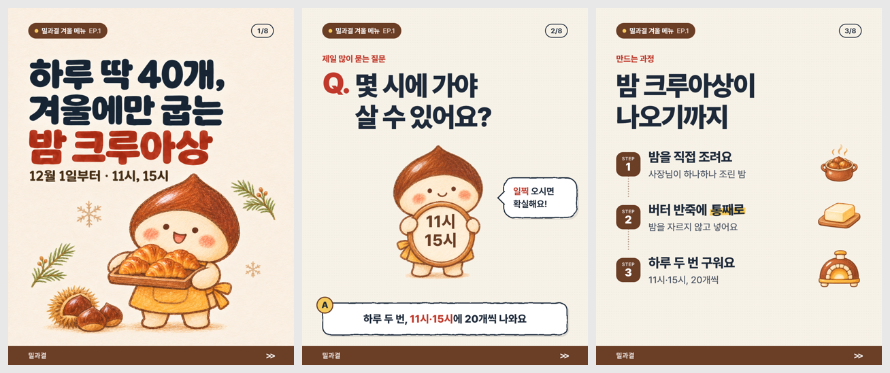</td>
    <td>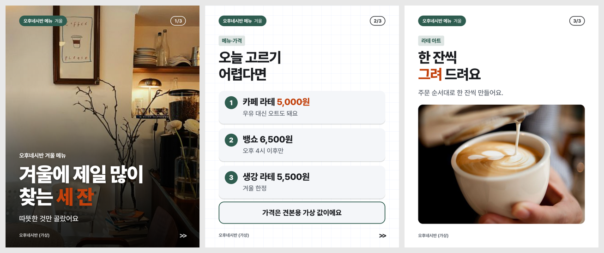</td>
  </tr>
  <tr>
    <td align="center">신메뉴 출시 (그림 표지)</td>
    <td align="center">메뉴·가격표 (사진 표지)</td>
  </tr>
  <tr>
    <td>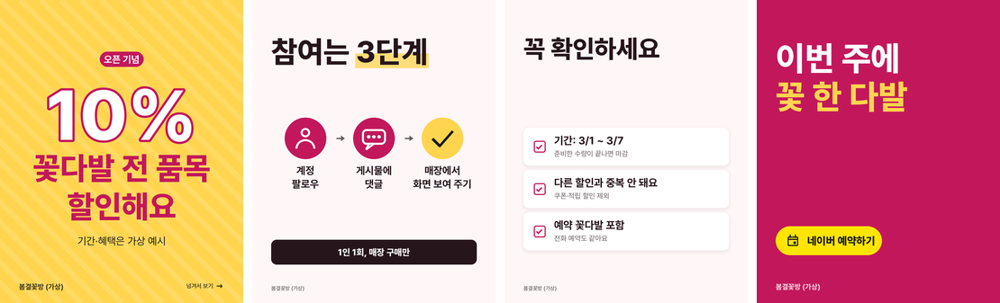</td>
    <td>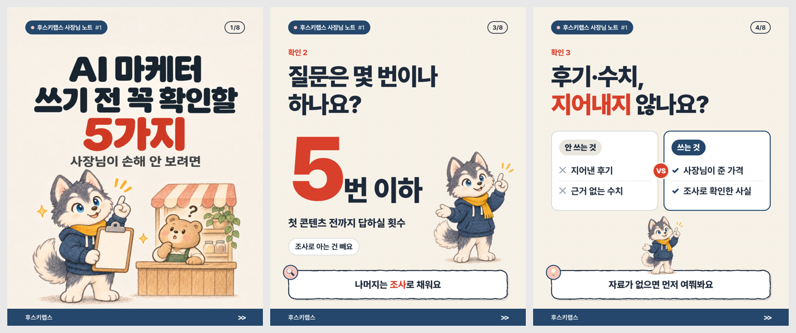</td>
  </tr>
  <tr>
    <td align="center">이벤트</td>
    <td align="center">정보·꿀팁</td>
  </tr>
</table>

다른 유형(공지·예약 안내·자주 묻는 질문)은 [gallery/cardnews/](gallery/cardnews/)에 있어요.

### 숏폼

<table>
  <tr>
    <td align="center" width="230">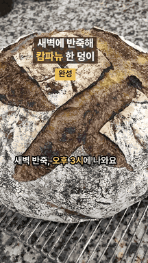<br><sub>만드는 과정 (<a href="gallery/shortform/G1.mp4">영상 G1.mp4</a>)</sub></td>
    <td>
      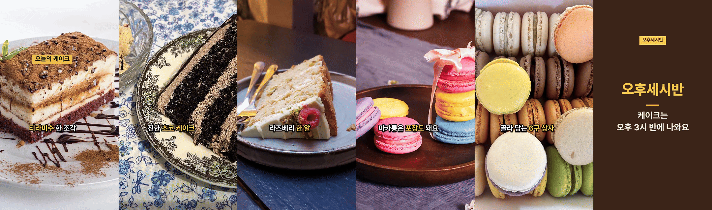<br>
      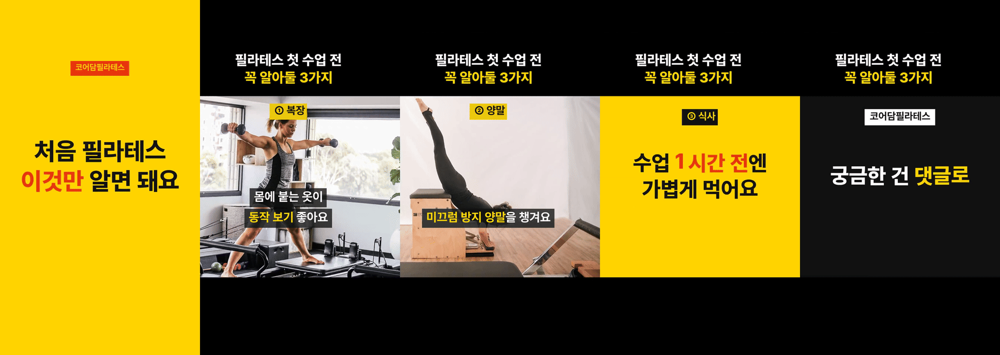
      <p><sub>위: 완성품 자랑 (<a href="gallery/shortform/G3.mp4">G3.mp4</a>) · 아래: 정보 카드 (<a href="gallery/shortform/G5.mp4">G5.mp4</a>)</sub></p>
    </td>
  </tr>
</table>

깃허브는 저장소 안의 mp4를 글 안에서 바로 재생하지 않아요. 링크를 누르면 영상을 볼 수 있어요. 다른 구성: [전후 비교](gallery/shortform/G2.mp4) · [가게 구경](gallery/shortform/G4.mp4) · [사장님이 직접 말하기](gallery/shortform/G6.mp4) · [오늘 하루](gallery/shortform/G7.mp4) · [가게 이야기](gallery/shortform/G8.mp4) · [유행 따라 하기](gallery/shortform/G9.mp4)

### 블로그

네이버 블로그 모바일 화면 모양으로 렌더한 견본 글이에요. 누르면 글 전체를 볼 수 있어요.

<table>
  <tr>
    <td><a href="gallery/blog/B03.png">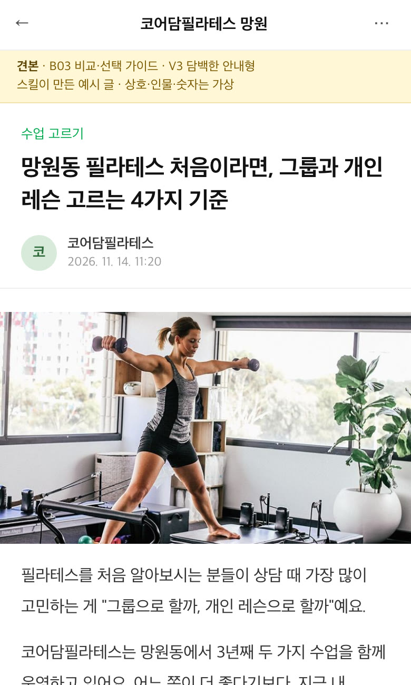</a></td>
    <td><a href="gallery/blog/B06.png">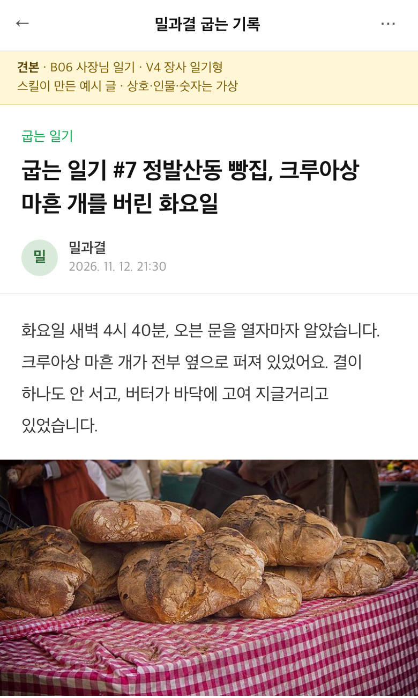</a></td>
    <td><a href="gallery/blog/B04.png">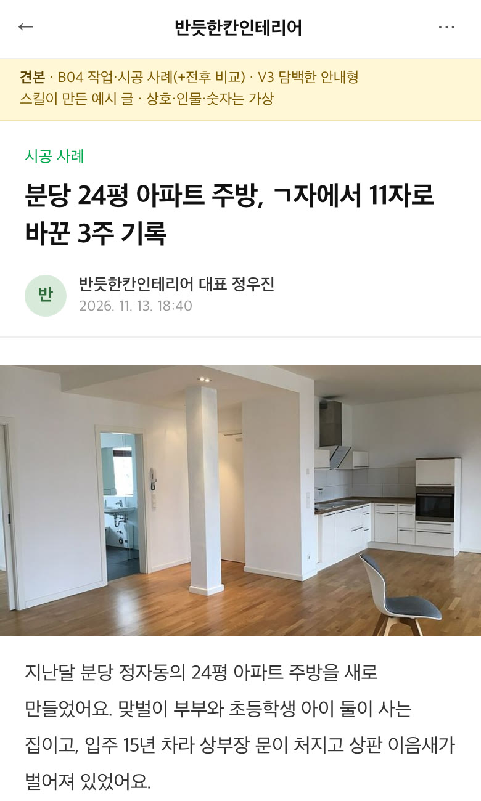</a></td>
  </tr>
  <tr>
    <td align="center">비교·선택 가이드</td>
    <td align="center">사장님 일기</td>
    <td align="center">시공 사례</td>
  </tr>
</table>

블로그 유형 13가지·문체 5가지 견본은 [gallery/blog/](gallery/blog/), 네이버 붙여넣기 묶음 예시는 [gallery/paste-bundle.png](gallery/paste-bundle.png)에 있어요.

## 자주 묻는 것

<details>
<summary><b>처음 시작(온보딩)은 어떻게 하나요?</b></summary>

에이전트에서 새 대화(또는 빈 새 폴더)를 열고, [사용법](#사용법)의 한 줄에 상호·지역·가게 링크(플레이스·인스타·홈페이지 중 아무거나)를 붙여 보내세요. 에이전트가 먼저 가게를 조사하고, 첫 콘텐츠까지 사장님 답은 5번 이하로만 물어요. 피클처럼 하루 사용량이 있는 에이전트는 첫날에 온보딩과 첫 콘텐츠 하나까지 하는 것으로 잡아 주세요. 나머지는 다음 날 이어서 해요.

</details>

<details>
<summary><b>어떤 업종이 되나요?</b></summary>

26개 업종 묶음을 지원해요(음식점·카페·미용·병의원·학원·운동·숙박·인테리어·부동산·전문직·B2B·소프트웨어·1인 브랜드 등). 목록은 [guides/industries/index.md](guides/industries/index.md).

</details>

<details>
<summary><b>이미 마케팅하고 있어도 되나요?</b></summary>

네. 지금 운영 중인 계정의 말투와 잘된 글을 먼저 보고 그 위에서 이어 가요. 블로그만, 인스타만처럼 일부만 맡겨도 돼요.

</details>

<details>
<summary><b>같은 업종이면 결과가 다 똑같나요?</b></summary>

뼈대(글 유형·장 구성)는 비슷할 수 있어요. 대신 가게마다 "브랜드 프로필(커스텀 지침서)"을 만들고, 가게 성격(동네 단골형·찾아오는 목적지형·전문형·기업 거래형)과 사장님이 고른 분위기 말 3개에 따라 문체·카드 디자인·숏폼 느낌·사진 톤·제목 틀의 기본값을 다르게 잡아요. 문장은 사장님이 준 사실과 사진으로 채우니, 자료가 다르면 결과도 달라져요. 처음 만들 때 시안 2개를 보여 드리고 고르게 해요([guides/styles/](guides/styles/)).

</details>

<details>
<summary><b>"이번 주 뭐 올리지?"도 정해 주나요?</b></summary>

네. 월요일에 "이번 주"라고만 보내면 밀린 확인을 먼저 하고 이번 주 할 일을 제안해요. 바로 쓸 소재가 모자라면 시즌·축제·검색 수요를 모으고 사장님께 3가지만 물어 근거 있는 주제 3개와 올릴 채널을 골라 드려요([guides/09-discovery.md](guides/09-discovery.md)). 위 [결과 예시](#이번-주-주제-찾기)를 보세요.

</details>

<details>
<summary><b>네이버 검색 자료는 어떻게 보나요?</b></summary>

네이버 약관은 허락 없이 프로그램으로 검색하는 것을 금지해요. 그래서 기본은 **네이버 공식 키(API)**로 봐요. 키가 없으면 사장님이 보낸 가게 링크·화면 캡처로 보고, 네이버에 검색어를 넣어 보는 건 사장님께 묻고 동의받은 뒤에만, 이 가게 몫만 조금 해요.

</details>

<details>
<summary><b>파이썬을 못 쓰는 에이전트면요?</b></summary>

조사·전략·블로그 글·법규 검수는 똑같이 돼요. 카드뉴스와 숏폼은 완성 그림·영상 대신 **장별 원고와 만드는 순서**(미리캔버스·캔바·캡컷에서 따라 만들기)로 나와요. 에이전트가 브라우저를 쓸 수 있으면 카드뉴스는 HTML로 만들어 캡처하기도 해요.

</details>

<details>
<summary><b>사진이 없으면요?</b></summary>

이번 주에 찍을 사진을 구체적으로 알려 드려요. 쓰시는 AI에 그림 그리기(이미지 생성) 기능이 있으면 누가 봐도 그림인 일러스트·배경을 만들어 카드뉴스·숏폼에 넣고, 글자는 정확하게 따로 얹어요. 실제 매장·상품처럼 보이는 AI 사진은 만들지 않아요.

</details>

<details>
<summary><b>업로드는 어떻게 연결하나요?</b></summary>

유튜브·인스타그램 등 공식 업로드는 **처음 한 번 계정 연결**(플랫폼 앱 만들기·로그인·"허용" 누르기)이 필요해요. 에이전트가 화면 순서대로 안내하고, 로그인과 보안문자는 사장님이 직접 해요. 15분 안에 연결이 안 되면 브라우저(메타 비즈니스 스위트·유튜브 스튜디오)나 사장님 폰으로 올리는 방법으로 바꿔요. 플랫폼별 안내는 [guides/upload/](guides/upload/).

</details>

<details>
<summary><b>내 정보는 어디에 저장되나요?</b></summary>

쓰는 에이전트의 기억과 사장님 구글 문서(브랜드 프로필)에만 저장돼요. 이 스킬이 가게 정보를 따로 모으지는 않아요. 결과가 이상할 때 제보를 권할 수 있는데, **사장님이 내용을 보고 허락할 때만** 공개 이슈로 올리고 상호·연락처 같은 가게 정보는 빼요.

</details>

## 들어 있는 것

<details>
<summary>파일 구성 보기</summary>

| 경로 | 내용 |
|---|---|
| `SKILL.md` | 에이전트가 처음 읽는 파일 (역할·규칙·단계) |
| `guides/00~09` | 시작, 스스로 조사, 질문, 전략, 주간 루프, 월간 회고, 레퍼런스, 디자인 키트, 운영, 이번 주 주제 찾기 |
| `guides/industries/` | 업종 26개 전략 파일 |
| `guides/compliance/` | 법규 검수 19가지 |
| `guides/styles/` | 블로그 유형·문체, 카드뉴스 유형·스타일, 숏폼 구성 고르기 |
| `guides/make/` | 블로그(네이버·티스토리), 카드뉴스, 숏폼, 동네 소식, 플랫폼별 변환, 그림 요소 |
| `guides/upload/` | 플랫폼 연결·업로드 안내 |
| `skills/` | 하위 스킬(블로그·카드뉴스·숏폼·검수·주제 찾기 등, 따로 설치해서 쓰기용) |
| `tools/` | 조사·주제 찾기 도우미(`mk.py`), 카드뉴스 렌더러(`cardnews_html.py`, 대체 `cardnews.py`), 숏폼 조립기(`shortform.py`), 업로드 도우미(`upload_api.py`) |
| `templates/cardnews-html/` | 카드뉴스 HTML 템플릿 |
| `templates/shortform-hyperframes/` | 숏폼 HyperFrames 템플릿 4개(시간 자막 루틴·정보 카드·쇼케이스·전후)와 만들기 스크립트 |
| `examples/` | 입력·출력 견본(블로그, 카드뉴스 원고, 숏폼 장면표, 네이버 붙여넣기 묶음) |
| `gallery/` | 스타일 예시(블로그·카드뉴스·숏폼) |
| `assets/readme/` | 이 README의 그림 |

</details>

## 주의사항

> [!IMPORTANT]
> - **법률 자문이 아니에요.** 법규 검수는 공개된 법령·지침을 기준으로 위험한 문장을 찾아 주는 도구예요. 병·의원 광고는 의료광고 사전심의 대상인지 꼭 확인하세요.
> - **올리기 전에 한 번 읽어 보세요.** 가격·영업시간·이벤트 조건은 사장님이 확인한 값만 써요.

- **네이버·틱톡은 사장님이 직접 올려요.** 두 곳 약관은 프로그램으로 로그인·게시하는 것을 금지하고, 2026년 공개 블로그 후기 중에 AI가 대신 올린 블로그가 검색에서 빠지거나 아이디가 잠겼다는 글이 여러 건 있었어요(글쓴이 본인 주장이고 네이버가 공식 확인한 것은 아니에요). 그래서 에이전트는 붙여넣기 묶음까지만 만들어요(네이버 블로그는 원하시면 임시저장까지).
- **네이버 조사는 공식 키로 해요.** 키 없이 네이버에 검색어를 넣어 보는 건 사장님 동의 뒤에만, 이 가게 몫만 해요.
- **협찬·체험단은 표시해야 해요.** 대가를 받은 후기에는 "광고·협찬" 표시가 필요해요.
- **사용량.** 무료 에이전트는 하루 사용량이 있어요. 한 번에 만들 양을 먼저 보여 드리고 진행해요.
- **제보할 때 가게 정보를 적지 마세요.** 이슈는 누구나 보는 공개 글이에요.

## 참고한 공개 자료

지침은 공개 자료의 아이디어와 구조를 참고해 우리 말로 새로 썼어요. 출처와 라이선스는 [NOTICE.md](NOTICE.md)에 적었어요.

## 라이선스

[MIT](LICENSE). 단 견본 사진과 폰트는 MIT 대상이 아니고 각 출처의 라이선스를 따라요([NOTICE.md](NOTICE.md)).

## 제보·문의

- 업종이 안 맞거나 결과가 이상하면 [이슈](https://github.com/Whosekey-Labs/kr-marketing-skill/issues/new)로 남겨 주세요. 이슈는 공개 글이니 개인정보는 적지 마세요.
- 깃헙 계정이 없으면 오픈채팅방으로 알려 주세요: https://open.kakao.com/o/g3vAeBWi
